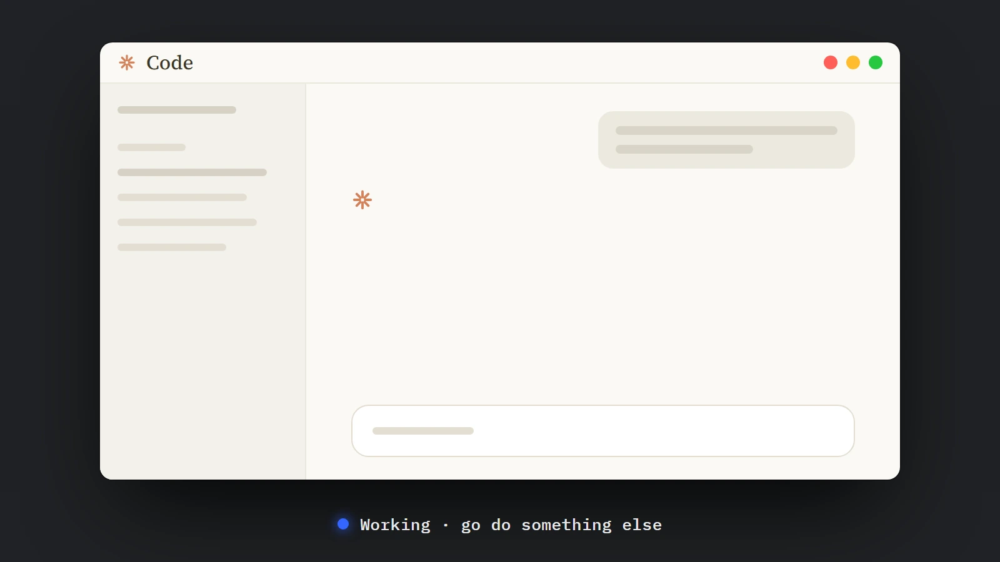
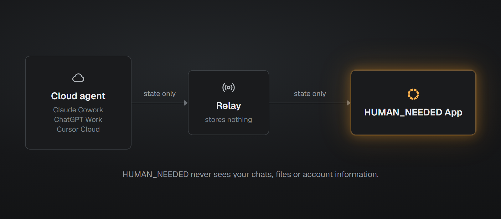

<h1>&nbsp;HUMAN_NEEDED</h1>

**Stop watching Claude work. Your screen glows when it's done or needs you.**

## Look away. Your screen calls you back.

You ask Claude to do something, then you wait, check back, wait again. Or you switch to
something else and forget it's waiting for you. HUMAN_NEEDED watches for you.

- 🟠 **Claude needs you.** The edges of your screen glow orange and a soft chime plays, until
  you answer a question or approve a step.
- 🟢 **Claude is done.** A short green glow, so you know the result is ready.
- ☁️ **Works with Cowork and cloud chats.** Claude chats that run in the cloud can't reach your
  PC, so most apps miss them. HUMAN_NEEDED gets their signal through a small relay, so they light
  your screen just like local ones.

## Make it yours

- **Fully customizable.** Colour, light, brightness, duration and sound for each state, or keep
  the defaults.
- **Every screen, every chat.** Works on all your monitors. Several chats at once? One signal
  covers them all, and "needs you" always wins.
- **Works with devices.** The HUMAN_NEEDED Puck, a desk light and chime, and third-party lights
  (coming soon).

## Get started

1. **[Download for Windows](https://github.com/human-needed/app/releases/latest)** and install it.
2. **[Connect Claude](https://human-needed.com/start/)**: install a HUMAN_NEEDED plugin.
3. Done.

## Cloud agents, privately

- **How it works:** in Cowork or Claude on the web, the plugin sends only the chat's state
  (working, needs you, done) to our relay, and the relay passes it to the app on your PC.
- **Your chats stay yours.** Neither the plugin nor the app reads your chats, prompts, code or
  files. Only the state, a scrambled chat id and a timestamp ever leave.
- **No account, no tracking.** The cloud link is off until you turn it on.

---

[Help and setup](https://human-needed.com/start/) · [Report a problem](https://github.com/human-needed/app/issues/new/choose) · [License (FSL)](LICENSE)

