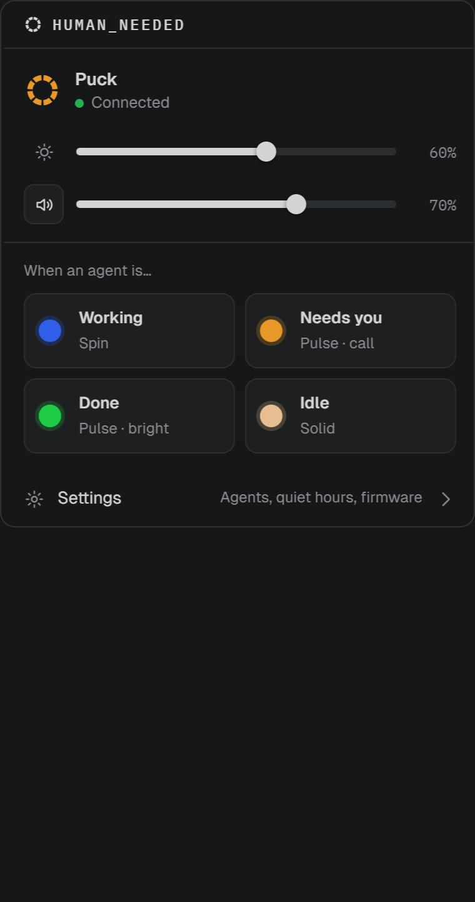

# HUMAN_NEEDED

[](https://github.com/human-needed/app/actions/workflows/ci.yml)
[](LICENSE)

**Know when your AI agent needs you, without watching it.**

HumanNeeded is a free tray app for Windows and macOS. It listens to your coding agents
(Claude Code, Codex, Cursor and others) and tells you when one is **working**, when it **needs
you**, and when it's **done**, so you can look away while it runs.



## What it does

- **One signal for every agent.** Sessions from all your agents and chats are merged into one
  state. "Needs you" always wins.
- **A tray icon in the state's colour.** Blue while working, orange when an agent needs you,
  green when it's done.
- **Your colours, lights and sounds.** Choose them for each state in the panel.
- **Quiet hours.** Sounds off and lights dimmed overnight.
- **Clears itself.** If an agent crashes or you close it, the signal goes away on its own.
- **Private.** Everything runs on your computer. The optional cloud link for Claude on the web
  passes only state changes, never your prompts or code.

## Install

Download the latest release from the [Releases page](https://github.com/human-needed/app/releases/latest):

- **Windows 10/11:** `HumanNeeded-windows-x64-setup.exe`. Installs for your user, no admin needed.
- **macOS** (Apple silicon and Intel): `HumanNeeded-macos-universal.dmg`. Drag HumanNeeded to
  Applications.

The builds aren't code-signed yet, so your OS warns you the first time:

- **Windows:** if SmartScreen says "Windows protected your PC", click **More info → Run anyway**.
- **macOS:** if macOS says it can't check the app, go to **System Settings → Privacy & Security →
  Open Anyway**, then open the app again.

Each release has a `SHA256SUMS.txt` you can check your download against. The app updates itself
(you choose when to restart), and every update is signed.

Then connect your agents: the setup guides are at **[human-needed.com/start](https://human-needed.com/start/)**.

## The puck (optional)

The app works on its own. If you want the signal on your desk, the **HumanNeeded puck** is a small
USB light with a chime that shows the same states across the room. Plug it in and the app finds
it. The panel then controls its light, colours and sounds, and updates its firmware.
More at [human-needed.com](https://human-needed.com).

## Help and feedback

Found a bug or have an idea? [Open an issue](https://github.com/human-needed/app/issues). If
something's wrong, include your OS, the app version (Settings → App) and, if you can, the log
(Settings → Advanced → Open log).

## Building from source

You need Rust (stable). Then:

```
cargo test --workspace
cargo build
```

How the app is put together, the event API for agent integrations and how to run it against
the puck simulator are in [docs/DEVELOPMENT.md](docs/DEVELOPMENT.md).

## License

[MIT](LICENSE). The bundled fonts (Geist, IBM Plex Mono) are under the SIL Open Font License;
see `app/ui/fonts`.
