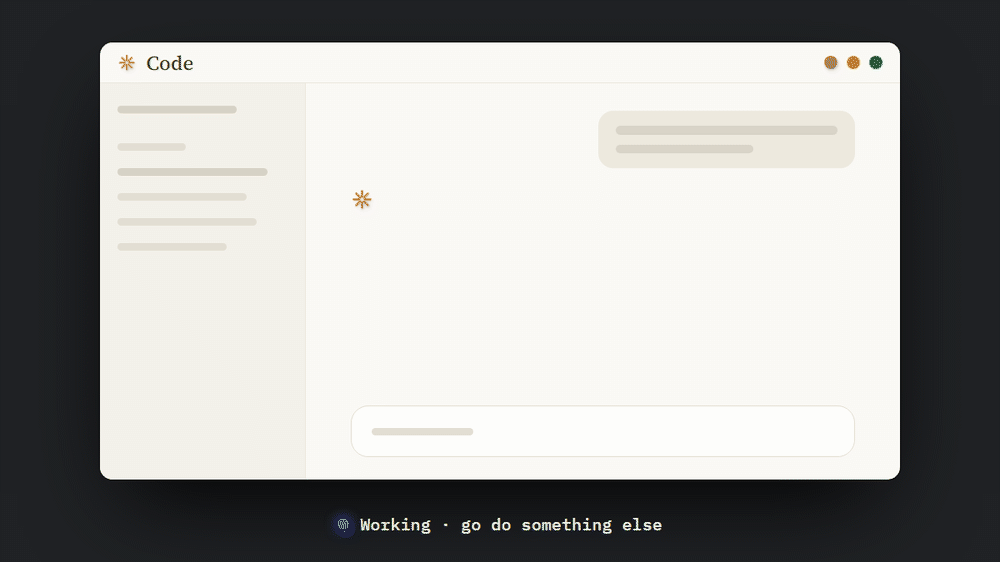
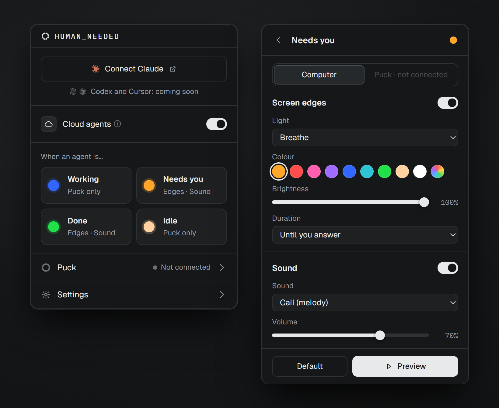

# HUMAN_NEEDED

### Stop watching Claude work. Your screen glows when it's done or needs you.

Free · Windows 10 and 11 · No account · Mac coming soon

## Look away. Your screen calls you back.

You ask Claude to do something, then you wait, check back, wait again. Or you switch to
something else and forget it's waiting for you. HUMAN_NEEDED watches for you.

- 🟠 **Claude needs you.** The edges of your screen glow orange and a soft chime plays, until
  you answer a question or approve a step.
- 🟢 **Claude is done.** A short green glow, so you know the result is ready.
- 🤫 **Never in your way.** No pop-ups, no stolen focus, clicks go straight through. Works on
  every monitor, with quiet hours for the evening.

## Make it yours

Click the ring in your tray. Pick a colour, light and sound for each state, or keep the
defaults. Several chats at once? One signal covers them all, and "needs you" always wins.

## Get started

1. **[Download for Windows](https://github.com/human-needed/app/releases/latest/download/HumanNeeded-windows-x64-setup.exe)** and open it.
   Windows may warn you the first time ([why, and what to click](#windows-warning)).
2. **[Connect Claude](https://human-needed.com/start/)**: a few clicks in the Claude app.
3. That's it. The app sits in your tray, starts with Windows and updates itself.

<b>Windows says "Windows protected your PC"</b>

 

HUMAN_NEEDED isn't code-signed yet, so Windows doesn't recognise the publisher. Click
**More info**, then **Run anyway**. If your browser warns that the file isn't commonly
downloaded, choose **Keep**. You only do this once, and the app installs without admin rights.

## Coming soon

- **Mac**
- **Codex and Cursor**
- **The HUMAN_NEEDED Puck:** an optional desk light and chime, for when you're away from the
  screen. [human-needed.com](https://human-needed.com)

## Private by design

Everything runs on your computer. There's no account, no tracking and no ads. Your chats, code
and files never leave your PC.

---

[Help and setup](https://human-needed.com/start/) · [Report a problem](https://github.com/human-needed/app/issues/new/choose) · [Developers](docs/DEVELOPMENT.md) · [License (FSL)](LICENSE)

