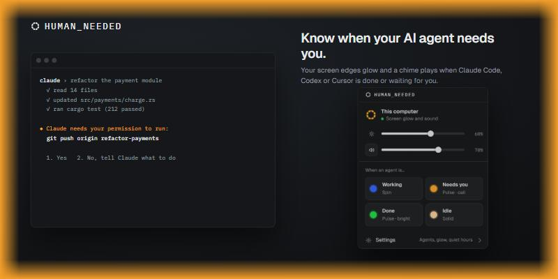
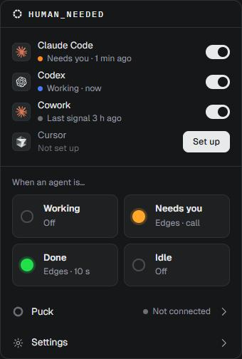
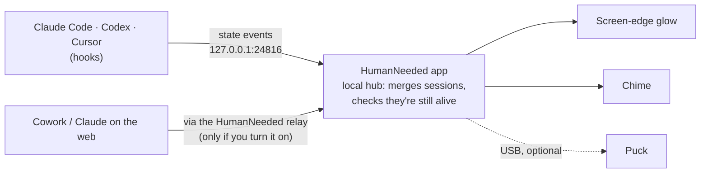

<div align="center">



# HUMAN_NEEDED

**Know when your AI agent needs you, without watching it.**

[](https://github.com/human-needed/app/actions/workflows/ci.yml)
[](https://github.com/human-needed/app/releases)
[](LICENSE)


[Website](https://human-needed.com) · [Download](https://github.com/human-needed/app/releases/latest) · [Setup guides](https://human-needed.com/start/) · [Report a bug](https://github.com/human-needed/app/issues/new/choose)

</div>

HumanNeeded is a free, open-source tray app for Windows and macOS. It listens to your coding
agents and tells you when one is **working**, **needs you**, or is **done**: the edges of your
screen glow in the state's colour and a short chime plays. Start a task, look away, and come
back when it's your turn.

## Features

- 🟠 **Screen-edge glow** on every monitor, in the state's colour and animation. It never takes
  focus or clicks.
- 🔔 **Chimes** for "needs you" and "done", with 15 sounds and melodies to choose from.
- 🤖 **Every agent, one signal:** Claude Code, Codex, Cursor and Cowork / Claude on the web.
  "Needs you" always wins.
- 🎨 **Your look:** colour, animation and sound for each state, plus brightness and volume.
- 🌙 **Quiet hours:** sounds off and the glow dimmed overnight. Mute for an hour from the tray.
- 🧹 **Clears itself:** if an agent crashes or you close it, its signal goes away on its own.
- 🔒 **Local first:** everything runs on your computer (see [Privacy](#privacy)).
- 💡 **Optional desk light:** add the [HumanNeeded puck](#the-puck-optional) to see it across
  the room.

## Screenshots

| Tray panel | Edge glow |
|---|---|
|  |  |

## Install

Download the latest release from **[Releases](https://github.com/human-needed/app/releases/latest)**:

| OS | File |
|---|---|
| Windows 10 / 11 (x64) | `HumanNeeded-windows-x64-setup.exe`: installs for your user, no admin needed |
| macOS (Apple silicon and Intel) | `HumanNeeded-macos-universal.dmg`: drag HumanNeeded to Applications |

> [!NOTE]
> The app isn't code-signed yet, so Windows and macOS warn you once. See
> [Installing an unsigned app](#installing-an-unsigned-app) below. After that, the app updates
> itself (signed updates, installed when you choose to restart).

### Installing an unsigned app

HumanNeeded isn't code-signed yet, so Windows and macOS don't recognise the publisher and warn
you once. The app is open source and built on GitHub from the public code. Same steps on the
site: [human-needed.com/help](https://human-needed.com/help/#unsigned).

**Windows**
1. If your browser says the file isn't commonly downloaded, choose **Keep**.
2. Open `HumanNeeded-windows-x64-setup.exe`.
3. On the blue "Windows protected your PC" screen, click **More info**, then **Run anyway**.
4. The installer runs for your user only; it doesn't ask for admin rights.

**macOS** (Apple silicon and Intel)
1. Open `HumanNeeded-macos-universal.dmg` and drag HumanNeeded to **Applications**.
2. Open HumanNeeded. macOS says it can't check it for malware: click **Done** (or **OK**).
3. Open **System Settings → Privacy & Security**, scroll down, and click **Open Anyway** next to
   HumanNeeded.
4. Confirm with **Open Anyway** and your password. You only do this once.

Only do this for files from [human-needed.com](https://human-needed.com/start/#app) or
[GitHub Releases](https://github.com/human-needed/app/releases). To check a file, compare it with
`SHA256SUMS.txt` on the release:

```powershell
certutil -hashfile HumanNeeded-windows-x64-setup.exe SHA256
```

```bash
shasum -a 256 HumanNeeded-macos-universal.dmg
```

The app lives in the tray (Windows) or the menu bar (macOS). Click the ring icon for the panel;
right-click it for **Screen edge glow**, **Mute for 1 hour** and **Quit**.

## Quick start: connect your agents

Install the app first, then add the agents you use. Full guides:
**[human-needed.com/start](https://human-needed.com/start/)**.

<details>
<summary><b>Claude Code</b> (terminal, desktop app, VS Code)</summary>

```bash
claude plugin marketplace add human-needed/plugins
```

```bash
claude plugin install humanneeded@humanneeded
```

Then turn on auto-update: in Claude Code type `/plugin` → **Marketplaces** → **humanneeded** →
**Enable auto-update**. Start a new session.
</details>

<details>
<summary><b>Codex</b></summary>

Add our hooks file to `~/.codex/hooks.json`:
[guide and one-line installer](https://github.com/human-needed/plugins#codex). Then restart Codex
and **approve the hooks** (`/hooks` in the CLI, or **Settings → Hooks** in the app).
</details>

<details>
<summary><b>Cursor</b></summary>

Add our hooks file to `~/.cursor/hooks.json`:
[guide and one-line installer](https://github.com/human-needed/plugins#cursor). Cursor picks it up
at once. It shows working and done (Cursor has no "needs you" hook).
</details>

<details>
<summary><b>Cowork and Claude on the web</b> (cloud)</summary>

Cloud tasks run in a cloud machine that can't reach your computer. Install the Claude Code
plugin above, then in the app turn on **Settings → Agents → Cowork**. The app links to the
HumanNeeded relay with your Claude account (signed in to Claude on this computer).
</details>

The panel shows each agent as **Connected** once it has sent an event.

## How it works



1. Each agent's **hooks** post its state (working, needs you, done) to the app on `127.0.0.1`.
2. The **local hub** merges every session into one state, with "needs you" first, and clears
   sessions whose agent has gone away.
3. The app shows that state: **glow and chime** on this computer, or on the **puck** when one
   is plugged in (the glow stays on too, if you like).

## Privacy

- **What the app reads, on your computer:**
  - the state events your agents' hooks send;
  - Claude Code's session files, to tell whether a session is still alive;
  - on Windows, the agent's process, for the same reason;
  - with the cloud link on, the account ID in Claude's config files.
- **What leaves your computer:** nothing, unless you turn on the **cloud link** (off by default).
  Then the app keeps a connection to the HumanNeeded relay to receive your cloud chats' states.
  It's addressed by a hash of your Claude account ID, never by your prompts, code or files.
- **No telemetry, no accounts, no ads.**
- **Update checks:** the app downloads its update file from GitHub Releases, and, when you ask,
  the puck's firmware list from human-needed.com. Neither sends anything about you.

## The puck (optional)

The **HumanNeeded puck** is a small USB desk light with a chime, for when you're away from the
screen: across the room, on a call, making coffee. Plug it in and the app finds it. The panel then
sets its colours, animations and sounds, and updates its firmware. Everything else works without
it. More at **[human-needed.com](https://human-needed.com)**.

## FAQ

<details>
<summary><b>Do I need the puck?</b></summary>

No. The app works on its own with the screen-edge glow and chimes. The puck is an extra.
</details>

<details>
<summary><b>Will the glow get in my way?</b></summary>

It never takes focus or clicks. It does show in screenshots and screen shares; pause it from
the tray menu before you share your screen.
"Working" glows softly and "Idle" never glows. Turn it off any time from the tray menu.
</details>

<details>
<summary><b>Does it slow my computer down?</b></summary>

Barely. It idles when nothing happens; the glow animates on the GPU compositor and stops when
there's nothing to show. The audio device is only opened while a chime plays.
</details>

<details>
<summary><b>Why does Windows or macOS warn me when I install it?</b></summary>

The app isn't code-signed yet. [These steps](#installing-an-unsigned-app) get you past it once.
Signing is planned.
</details>

<details>
<summary><b>Which agents work?</b></summary>

Claude Code, Codex, Cursor, and Cowork / Claude on the web. Anything that can run a hook can post
to the app's [event API](docs/DEVELOPMENT.md#for-agent-integrations-app-events-20).
</details>

## Troubleshooting

| Problem | Fix |
|---|---|
| An agent shows **Not set up** | Install its plugin or hooks ([quick start](#quick-start-connect-your-agents)), then start a new session. Codex: approve the hooks. |
| Nothing lights up and you use a proxy | Add `127.0.0.1` to `NO_PROXY`. The panel shows the exact line. |
| "Agents can't reach the app" | Another program uses port 24816. Close it or restart your computer. |
| No sound | Check the volume and mute button in the panel, and quiet hours in Settings. |
| Cursor never shows "needs you" | Cursor has no hook for it yet: only working and done. |
| Windows or macOS won't open the installer or app | See [Installing an unsigned app](#installing-an-unsigned-app). |

Still stuck? [Open an issue](https://github.com/human-needed/app/issues/new/choose) with the log
from **Settings → Advanced → Open log**.

## Uninstall

In the app, open **Settings → Advanced → Uninstall HumanNeeded…**. Choose whether to keep your
settings for a later install. It removes the app, its start-at-login entry, the cloud link's saved
credential, its log and its cache, and nothing else.

- **Windows:** you can also use **Settings → Apps → Installed apps → HumanNeeded → Uninstall**.
  Tick **Delete the application data** to remove your settings too.
- **macOS:** if you already dragged the app to the Trash, its start-at-login entry removes
  itself at your next sign-in. To remove the rest: `~/Library/Application Support/HumanNeeded`
  (settings and log), the `com.human-needed.app` folders in `~/Library/Caches` and
  `~/Library/WebKit`, and the **HumanNeeded** item in Keychain Access.

Your agents' plugins and hooks belong to the agents: remove the Claude Code plugin with
`claude plugin uninstall humanneeded@humanneeded`, and our entries from `~/.codex/hooks.json`
and `~/.cursor/hooks.json`.

## Build from source

You need [Rust](https://rustup.rs) (stable). On Linux, also Tauri's
[system packages](https://v2.tauri.app/start/prerequisites/#linux), `libudev-dev` and `libasound2-dev`.

```bash
git clone https://github.com/human-needed/app && cd app
```

```bash
cargo test --workspace
```

```bash
cargo run -p humanneeded
```

The code layout, the event API for agent integrations and the puck simulator are in
[docs/DEVELOPMENT.md](docs/DEVELOPMENT.md).

## Contributing

Bug reports, ideas and pull requests are welcome. Read [CONTRIBUTING.md](CONTRIBUTING.md) first:
commits need a DCO sign-off (`git commit -s`). Security problems go privately through
[SECURITY.md](SECURITY.md). Release notes are in [CHANGELOG.md](CHANGELOG.md).

## License

HumanNeeded is free software: you can redistribute it and/or modify it under the terms of the
[GNU General Public License v3.0 or later](LICENSE). The bundled fonts (Geist, IBM Plex Mono) are
under the SIL Open Font License 1.1 (`app/ui/fonts`).

© 2026 HumanNeeded contributors · [human-needed.com](https://human-needed.com)
